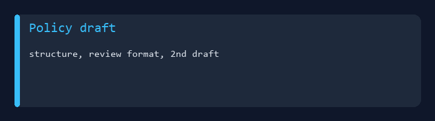
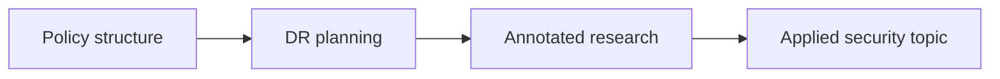

# IA 329 - Policy Development for Information Assurance



College coursework portfolio for **IA 329** at Eastern Michigan University.  
**Policy** drafts and review formats, **disaster recovery** planning structure, **annotated bibliographies**, and an applied **smart home security** paper.

**Author:** [Julio Barros](https://github.com/Jkbarros)  
**Index:** [college-projects](https://github.com/Jkbarros/college-projects)

## What is in this repository

| Area | Description |
|------|-------------|
| [Submissions catalog](docs/submissions-catalog.md) | All assignments grouped by theme |
| [Policy plan (1st draft)](docs/policy-plan-first-draft.md) | Initial policy plan template |
| [Policy review format](docs/policy-review-format.md) | Structured policy review |
| [IA329 second draft](docs/ia329-policy-second-draft.md) | Policy second-draft template |
| [Paper policy structure](docs/paper-policy-structure.md) | Full policy paper outline |
| [DR plan structure](docs/dr-plan-structure-template.md) | Disaster recovery template |
| [Bibliography — organizations](docs/annotated-bibliography-organizations.md) | Security orgs research |
| [Bibliography — privacy laws](docs/annotated-bibliography-privacy-laws.md) | Privacy law sources |
| [Smart home security paper](docs/smart-home-security-paper.md) | Applied writing assignment |
| [Archive index](docs/archive-index.md) | Links to original DOCX |
| [`archive/canvas-submissions/`](archive/canvas-submissions/) | Canvas exports |

### Highlights

- All nine DOCX files converted to GitHub-readable markdown
- Course thread: **policy lifecycle** → **DR** → **governance research** → **topic paper**

## Topics covered



## Regenerate docs

```bash
pip install -r requirements.txt
python scripts/docx_to_markdown.py
python scripts/generate_readme_demo.py
```

## Related repos

| Course | Link |
|--------|------|
| IA 103 - Information Security Overview | [information-security-overview](https://github.com/Jkbarros/information-security-overview) |
| IA 244 - Administration of Computer Systems | [ia244-administration-computer-systems](https://github.com/Jkbarros/ia244-administration-computer-systems) |
| college-projects index | [college-projects](https://github.com/Jkbarros/college-projects) |

## Notes for readers

- This repo documents **my submitted work** for academic context only.
- EMU or publisher course materials are not redistributed beyond my own submissions in `archive/`.

## License

Content © Julio Barros. Use at your own risk.
