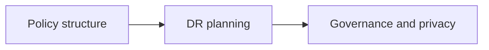

# IA 329 - Policy Development for Information Assurance

College coursework archive for **IA 329 - Policy Development for Information Assurance** at Eastern Michigan University.  
Policy templates, disaster-recovery planning structure, annotated bibliographies, and policy drafts.

**Author:** [Julio Barros](https://github.com/Jkbarros)  
**Index:** [college-projects](https://github.com/Jkbarros/college-projects)

## What is in this repository

| Area | Description |
|------|-------------|
| [Archive index](docs/archive-index.md) | Catalog of files in `archive/` with direct links |
| [`archive/canvas-submissions/`](archive/canvas-submissions/) | Policy/draft templates, bibliographies, smart-home security paper |

### Highlights

- IA329 policy second draft template
- DR plan structure and policy review formats
- Annotated bibliographies (privacy laws and organizations)

## Topics covered

## Related repos

| Course | Link |
|--------|------|
| IA 103 - Information Security Overview | [information-security-overview](https://github.com/Jkbarros/information-security-overview) |
| college-projects index | [college-projects](https://github.com/Jkbarros/college-projects) |

## Roadmap

- [ ] Convert key submissions to markdown in `docs/` (same pattern as IA 103)
- [ ] Redact any sensitive identifiers before expanding public docs

## Notes for readers

- This repo documents **my submitted work** for academic context only.
- EMU or publisher course materials are not redistributed beyond my own submissions in `archive/`.

## License

Content © Julio Barros. Use at your own risk.
